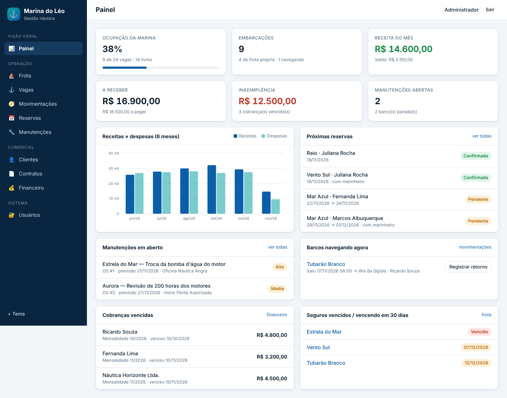

# ⚓ Marina do Léo

Sistema de **gestão de frota de barcos e administração de marina**: vagas, contratos, clientes, reservas/aluguel, movimentações, manutenção e financeiro, em um único painel web.



## Como rodar

Requisito: **Node.js 22.13 ou superior** (usa o SQLite embutido no Node — nada para instalar além do Express).

```bash
npm install
npm start
```

Abra **http://localhost:3000** e entre com:

| E-mail | Senha |
|---|---|
| `admin@marinadoleo.com.br` | `admin123` |

> **Troque a senha no primeiro acesso** (clique no seu nome → Meu perfil). Também dá para definir o admin inicial com `ADMIN_EMAIL` e `ADMIN_SENHA` antes do primeiro `npm start`.

Na primeira execução o banco (`data/marina.db`) é criado com **dados de exemplo** para você explorar. Para começar com o banco vazio: apague `data/marina.db` e rode `SEED=0 npm start`.

| Variável | Padrão | Para quê |
|---|---|---|
| `PORT` | `3000` | Porta HTTP |
| `DB_FILE` | `data/marina.db` | Arquivo do banco SQLite |
| `SEED` | `1` | `0` desativa os dados de exemplo |
| `ADMIN_EMAIL` / `ADMIN_SENHA` | ver acima | Usuário admin criado no 1º uso |

## Módulos

| Módulo | O que faz |
|---|---|
| **Painel** | Ocupação da marina, receita do mês, a receber, inadimplência, gráfico de 6 meses, próximas reservas, OS abertas, barcos navegando, seguros a vencer |
| **Frota** | Cadastro de embarcações (próprias e de clientes): tipo, fabricante, comprimento, inscrição na Capitania, motorização, capacidade, seguro, diária. Ficha do barco com histórico completo |
| **Vagas** | Mapa visual da marina (molhadas, secas/hangar, poitas) com ocupante de cada vaga; tarifa e comprimento máximo |
| **Movimentações** | Diário de saídas, retornos, içamentos, descidas, abastecimento — o status do barco ("Em uso") é atualizado sozinho |
| **Reservas** | Aluguel dos barcos da frota própria, com calendário mensal, cálculo automático do valor pela diária e bloqueio de conflitos de agenda |
| **Manutenções** | Ordens de serviço com prioridade, previsão, responsável/oficina e custo; barco fica "Em manutenção" enquanto houver OS aberta |
| **Clientes** | Proprietários e locatários, habilitação náutica; ficha com barcos, contratos, reservas e extrato financeiro |
| **Contratos** | Locação de vaga por barco: valor mensal, dia de vencimento; ocupa/libera a vaga automaticamente |
| **Financeiro** | Receitas e despesas, baixa de pagamentos, inadimplência, geração de mensalidades do mês em um clique, exportação CSV |
| **Usuários** | Perfis **Administrador** (tudo) e **Operador** (dia a dia; sem gestão de usuários nem exclusão de lançamentos) |

### Regras de negócio automáticas

- Uma vaga só aceita um contrato ativo, e o barco precisa caber no comprimento máximo da vaga.
- Um barco não pode ter dois contratos de vaga ativos.
- Reservas só para barcos da frota própria, sem sobrepor outra reserva, uma manutenção aberta ou a capacidade do barco.
- Reserva confirmada → gera conta a receber; cancelada → cobrança pendente é cancelada.
- OS concluída com custo → despesa (barco da frota) ou cobrança ao proprietário (barco de cliente).
- "Gerar mensalidades" cria as cobranças da competência para todos os contratos ativos, sem duplicar.
- Cobrança pendente após o vencimento aparece como **Vencido**.

## Estrutura

```
server.js            inicia o servidor
server/db.js         esquema do banco (SQLite)
server/auth.js       login, senhas (scrypt) e sessões
server/resources.js  cadastros, validações e regras de negócio
server/app.js        API REST
server/seed.js       dados de exemplo
public/              interface web (HTML/CSS/JS, sem build)
test/                testes automatizados da API
```

## Testes

```bash
npm test
```

## Backup

Todos os dados ficam em `data/marina.db`. Para backup, copie esse arquivo (de preferência com o sistema parado) ou use `sqlite3 data/marina.db ".backup backup.db"`.
